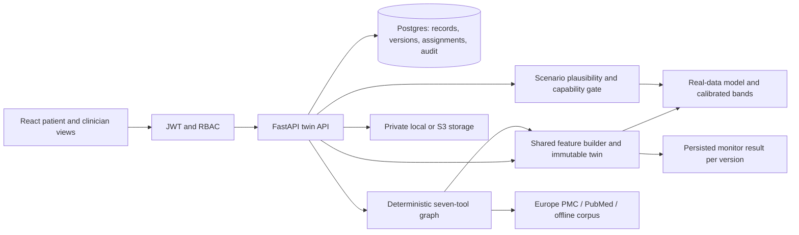

# Architecture

Iiris continues the existing FastAPI/SQLAlchemy/scikit-learn and React/Tailwind
application. The frozen theme remains in tailwind.config.js and src/index.css.

A new observation is validated, stored, transformed by the same feature builder
as training, predicted, assigned a new version and checked by the monitor. The
state and monitor result are persisted before the transaction commits. Historical
versions are replayed without recomputation. Postgres row locks serialize twin
refreshes for a patient; SQLite is a local development option.

Calendar dates and source-recorded relative follow-up months are separate clocks.
A patient record cannot mix them. DIMS publishes only scheduled months; dates
remain null in the DB, API, charts and FHIR. Unknown age/sex/exposures remain null
or NaN. Model temporal features use elapsed months, never fabricated dates.

Patients access their own /me routes. Clinicians use assigned /patients records.
Admins manage assignments and query access audit. Generic agent requests need an
explicit authorized patient; tools cannot enumerate arbitrary records. FHIR reads
use the same assignment checks. Upload association checks apply on create/update.

The registered agent tools are get_twin, predict, simulate, explain,
retrieve_evidence, compare_scenarios and flag_changes. The graph plans, executes,
checks, and composes from tool output. Optional narration can use loopback Ollama
only; all numbers must be traceable. The default LLM_PROVIDER=none is fully usable.

Model training uses separate patient groups for fitting, calibration and testing.
Six fixed point-model candidates are compared over three repeated four-fold
patient-grouped CV runs using training patients only; minimum mean fold MAE selects
per target. Current models predict change plus measured baseline; absent anchors
use a trained absolute fallback with an unvalidated-missing-pattern warning.
Quantile intervals use patient-maximum conformal scores on held-out calibration
patients. Test metrics include cluster bootstrap CIs and carry-forward/Ridge/RF
comparisons. The candidate set is fixed before evaluation; test
scores do not choose hyperparameters. Post-selection CV scores are not nested
evaluation, and the test benchmark was previously reported. No risk classifier is released when its
independent test labels are insufficient. Exposure what-ifs are rejected when
the training source cannot support them. Multi-year bands are heuristic rollouts,
not calibrated long-horizon confidence intervals.

Routes load lazily; Chart.js is absent from the initial landing/auth bundle.
Clinician screens add cohort search/status, measured history, prediction bands,
attribution, version diff, new observations/monitor, scenarios and cited agent
traces. The public model card discloses the tiny test cohort, baseline comparisons and unavailable 95% accuracy claim.

Readiness checks DB/model. Middleware caps request bodies, limits auth/compute
by IP and verified subject, appends security/request-ID headers and persists
patient read/write attempts to an independent audit transaction. Application logs
omit patient bodies, questions and query strings. Rate limits are single-worker
only and require shared persistence before horizontal scaling.
